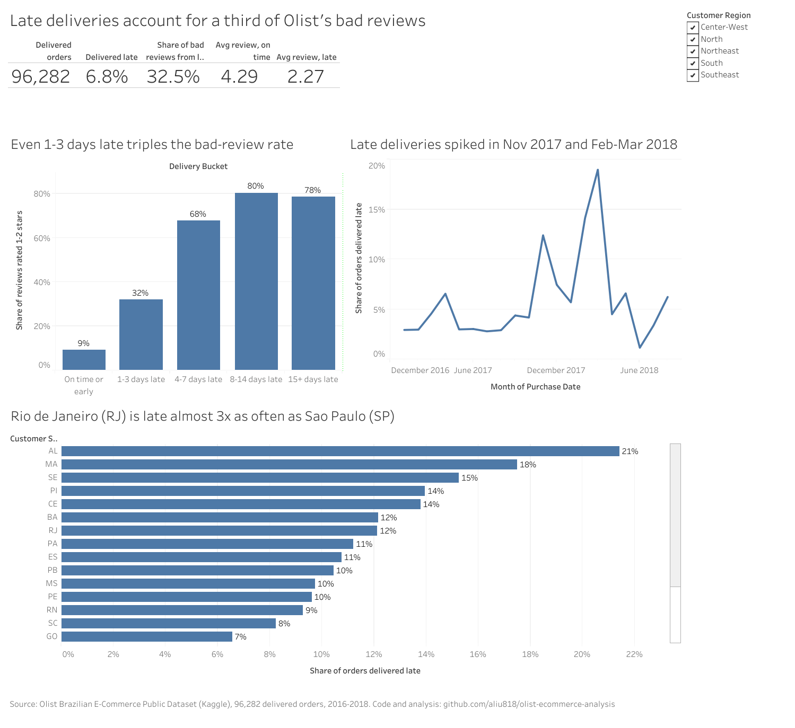

# Late Deliveries and Bad Reviews: Olist E-commerce Analysis

**Business question:** Why do marketplace customers leave bad reviews and rarely come back, and what should the company fix first?

**Short answer:** Late delivery is the biggest driver of bad reviews. Late orders are **6.7% of reviewed orders but 32.5% of all 1–2 star reviews**. Customers judge delivery against the date they were promised, not against how fast it is, so missed promises do far more damage than slow ones. Most lateness happens in transit with the carrier and clusters in a few states and peak months. Late delivery also lowers repeat purchases, but only slightly: about 97% of customers never order again anyway.

**Tools:** Snowflake · SQL · Python (pandas, SciPy, statsmodels) · Tableau Public · Git/GitHub
**Data:** ~100,000 real orders from Olist, a Brazilian marketplace, 2016–2018 (9 related tables)

**Interactive dashboard:** [View on Tableau Public](https://public.tableau.com/app/profile/adena.liu/viz/OlistLateDeliveriesandBadReviews/Dashboard1)



---

## Key findings

**Late delivery and reviews**

1. **Late orders get far worse reviews.** 62% of late orders get a 1–2 star review, vs. 9% of on-time orders (difference +53 percentage points, 95% CI +52 to +54). Average score: 2.27 vs. 4.29 stars.
2. **Even a small delay matters.** Arriving just 1–3 days late more than triples the bad-review rate (9% → 32%). At 4+ days late, most reviews are bad.
3. **Late delivery accounts for about 28% of all bad reviews.** If late orders were reviewed like on-time ones, there would be about 3,400 fewer bad reviews. In the North and Northeast regions, late orders make up 47% of bad reviews.
4. **Customers judge the promise, not the speed.** In the far north (Amazonas, Amapá, Rondônia, Acre), deliveries take 19–27 days, but Olist promises 39–47, so only about 3% arrive late. Reviews there average 4.1–4.2 stars, close to São Paulo's 4.25, where delivery takes under 9 days. (Small samples: 535 orders combined.)

**Where lateness comes from**

5. **Carriers, not sellers, cause most lateness.** Late orders spend 28 days in transit vs. 8 for on-time orders. In 72% of late orders, the seller shipped on time.
6. **Sellers still matter.** When a seller misses its shipping deadline (9% of orders), the order is about 4× more likely to arrive late (20.8% vs. 5.4%).
7. **Lateness is concentrated.** Rio de Janeiro is late 12.1% of the time vs. 4.5% for São Paulo; together they account for about half of late orders. Three months (Nov 2017, Feb 2018, Mar 2018) also produced about half of all late orders, peaking at 19% late in March 2018.

**What else drives bad reviews** (logistic regression, other factors held fixed)

8. **Late delivery: 18× the odds** of a bad review. Nothing else in the model comes close.
9. **Multi-seller and multi-item orders are a second driver.** Orders with items from 2+ sellers have 3.5× the odds of a bad review, and orders with 2+ items have 2.9× the odds. Olist ships each seller's items separately, so customers likely receive partial orders.
10. **Longer promises have a small cost.** Each extra promised day raises the odds of a bad review by about 2% (about 1.5× over 20 days). That's minor compared with the 18× cost of breaking the promise.

**Retention**

11. **Retention is low for everyone.** Only 3.1% of customers (2,997 of 96,096) ever placed a second order. A late first order lowers the return rate from 2.94% to 1.99%: statistically real (p < 0.001) but small in business terms.

## Recommendations (in priority order)

1. **Fix carrier performance where it's worst.** Start with Rio de Janeiro and the Northeast, and plan extra carrier capacity for peak periods like Black Friday. This targets the largest share of late orders.
2. **Make delivery promises accurate, not just fast.** Promised dates should come from each route's real delivery times, as they effectively do in the far north. A slightly longer promise costs a little (finding 10); a broken one costs far more (finding 8). Because longer promises could also reduce sales, this should be A/B tested before rollout.
3. **Enforce seller shipping deadlines.** A missed deadline nearly quadruples the chance of a late order and affects 9% of orders.
4. **Improve communication on multi-seller orders.** Clear "your order arrives in N parcels" messaging and per-parcel tracking is a cheap fix for a strong bad-review driver.
5. **Treat retention as a separate problem.** Better delivery protects ratings and reputation but won't fix repeat purchases on its own: 97% of customers don't return even after a perfect order.

**Proposed next step:** an A/B test of route-based delivery estimates, with bad-review rate as the success metric and checkout conversion as the guardrail.

---

## Data

- [Brazilian E-Commerce Public Dataset by Olist](https://www.kaggle.com/datasets/olistbr/brazilian-ecommerce) (Kaggle): about 100,000 orders from 2016–2018 across 9 related tables. Licence: CC BY-NC-SA 4.0.
- The raw CSVs are not committed to this repo. Download them from Kaggle to reproduce the work.

## Method

| Stage | What was done | Where |
|---|---|---|
| Load | Loaded all 9 CSVs into Snowflake as text (RAW schema) so nothing changed on the way in; row counts verified against the source | `sql/01_raw_load/` |
| Data quality | 33 checks across uniqueness, completeness, referential integrity, coverage, date validity, value validity and consistency, plus follow-up queries; every issue documented with a decision | `sql/02_data_quality/`, [data-quality log](docs/data_quality_log.md), [scorecard](docs/dq_scorecard_results.csv) |
| Staging | Typed and renamed columns, applied the data-quality rules (one review per order, flags for impossible dates, translated categories) | `sql/03_staging/` |
| Data model | Star schema: 2 fact tables (orders, order items) and 4 dimensions (customer, seller, product, date) | `sql/04_marts/`, [ERD](docs/erd.md) |
| SQL analysis | Late delivery vs. reviews, first-order experience vs. return, seller vs. carrier delays, late rate by state and month | `sql/05_analysis/` |
| Statistics | Mann-Whitney U and two-proportion z-tests with 95% CIs; logistic regression of bad reviews with odds ratios. The Python results reproduce the SQL figures exactly, as a cross-check | `python/01_statistics.py`, [results](python/output/01_statistics_output.txt) |
| Dashboard | Tableau Public: KPIs, bad-review rate by lateness, late rate by month and state, region filter | [Tableau Public](https://public.tableau.com/app/profile/adena.liu/viz/OlistLateDeliveriesandBadReviews/Dashboard1) |

**Key data-quality decisions** (full list in the [log](docs/data_quality_log.md)):

- `customer_id` is created fresh for every order; the real customer is `customer_unique_id`. Using the wrong one would make almost every customer look like a one-time buyer.
- 547 orders had more than one review; the most recent one is kept.
- 189 orders with dates in an impossible order are flagged and excluded from delivery analysis.
- Revenue is item price + freight, because payments differ slightly on 303 orders (likely instalment interest).
- A customer "came back" only if they placed another valid order on a **later day**, so several orders placed at once don't count as a return.

## Repo structure

```
├── sql/
│   ├── 01_raw_load/       # Snowflake setup, stage, raw tables, COPY INTO
│   ├── 02_data_quality/   # scorecard and follow-up checks
│   ├── 03_staging/        # cleaned staging views
│   ├── 04_marts/          # star schema
│   └── 05_analysis/       # analysis queries and export for Python
├── python/
│   ├── 01_statistics.py   # hypothesis tests and logistic regression
│   └── output/            # saved results
├── dashboard/             # dashboard screenshot
├── docs/                  # data-quality log, scorecard results, ERD
└── requirements.txt
```

## How to reproduce

1. Download the Olist dataset from Kaggle.
2. In Snowflake, run the files in `sql/01_raw_load/` in order, uploading the CSVs to the stage after `01_stage_and_format.sql` has run. Then run `sql/02_data_quality/`, `sql/03_staging/` and `sql/04_marts/`.
3. Run the queries in `sql/05_analysis/`. Download the result of `05_export_for_python.sql` as CSV and save it as `data/orders_for_stats.csv`.
4. Run the statistics:

   ```bash
   pip install -r requirements.txt
   mkdir -p python/output
   python python/01_statistics.py
   ```

## Limitations

- **Association, not proof of cause.** This is observational data. Late orders may differ in other ways (for example product type or distance) that also affect reviews. An experiment would be needed to prove cause.
- **Return window.** Customers who ordered near the end of the data had less time to come back, so the return analysis only uses first orders placed before 1 March 2018 (about six months of follow-up).
- **Recent months look better than they were.** Orders still in transit when the data ends aren't counted as delivered, which flatters mid-2018 late rates.
- **The model explains part of the picture.** The logistic regression's pseudo R² is 0.17; many bad reviews are driven by things this data doesn't capture, such as product quality.
- **Small samples in the far north.** Finding 4 rests on 535 orders across four states, so it supports the "promise, not speed" pattern rather than proving it.
- **Carriers aren't named in the data,** so recommendations target states and periods rather than specific carriers.
- **The geolocation table wasn't used.** Customer and seller state were enough for this question; distance-based analysis is a possible extension.
