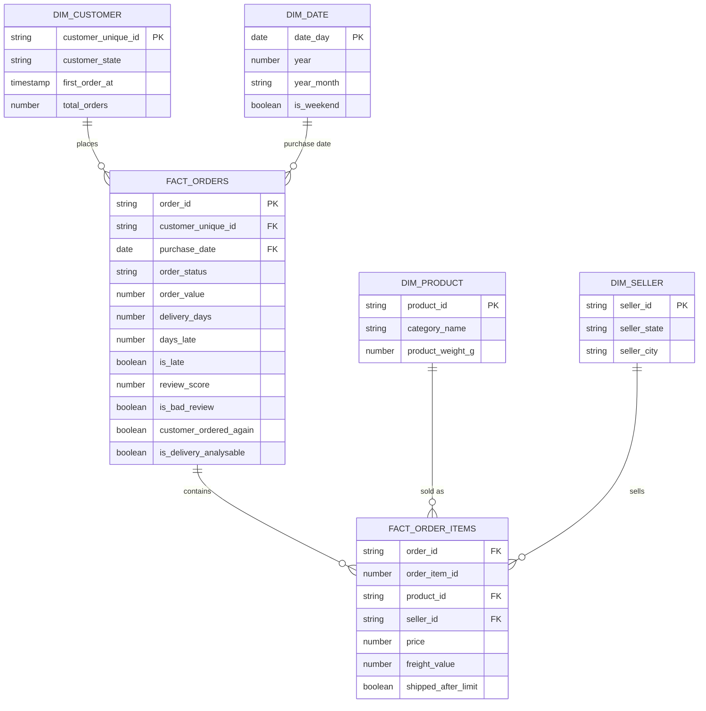

# Data model (star schema)

Built in Snowflake: `RAW` → `STAGING` → `MARTS`. SQL in `sql/04_marts/01_star_schema.sql`.

| Table | Grain (one row per) | Rows |
|---|---|---|
| FACT_ORDERS | order | 99,441 |
| FACT_ORDER_ITEMS | item sold | 112,650 |
| DIM_CUSTOMER | real customer (`customer_unique_id`) | 96,096 |
| DIM_SELLER | seller | 3,095 |
| DIM_PRODUCT | product | 32,951 |
| DIM_DATE | day, 2016-01-01 to 2018-12-31 | 1,096 |